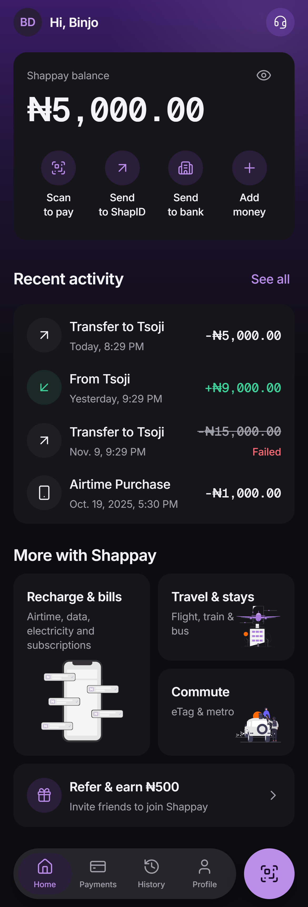
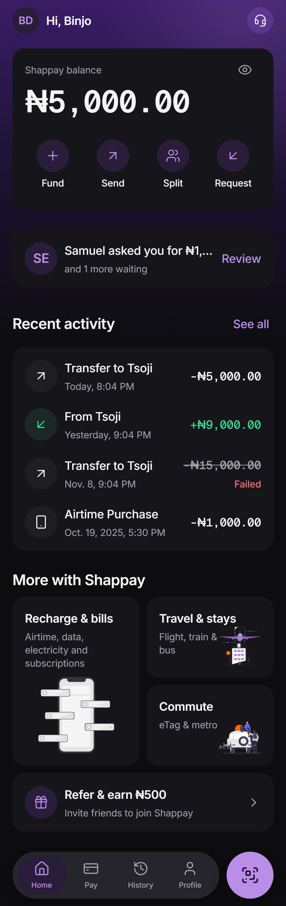
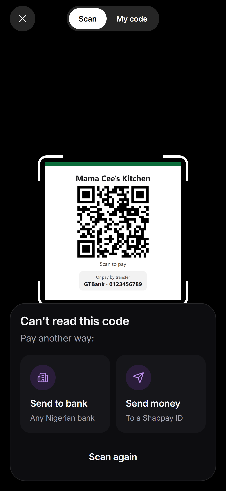
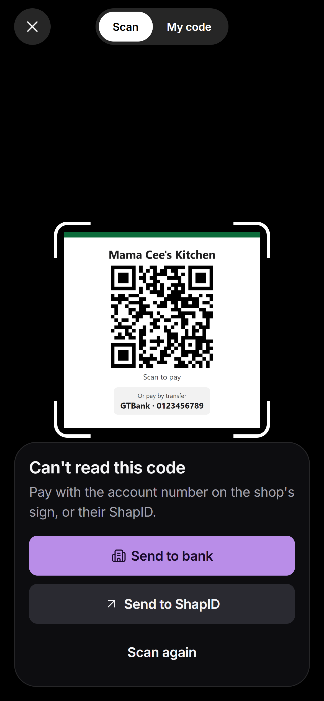
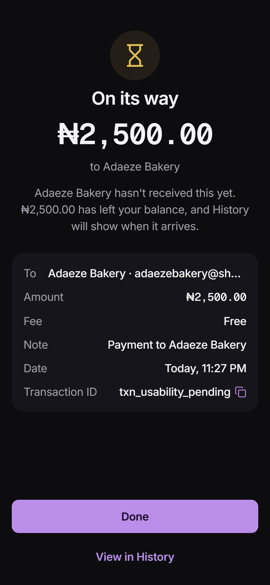
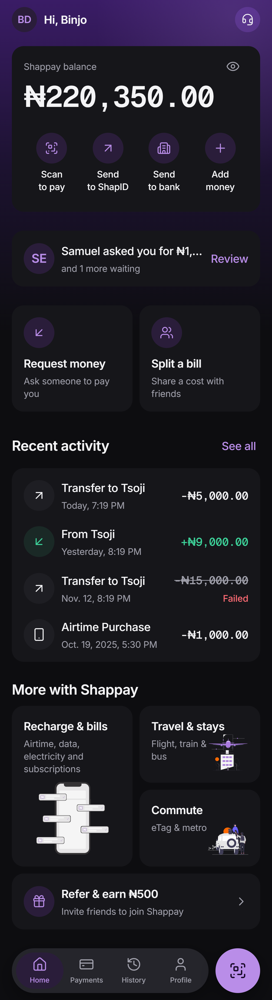

# Redesigning Shappay's ways to pay

A usability test showed that people couldn't find Shappay's ways to pay, so I redesigned the payment screens and ran the same test on the redesign.

| | |
|---|---|
| **Role** | Design engineer, leading product design. I ship my designs in code for the frontend engineer to review. |
| **Team** | Me, a product manager, a frontend engineer and a backend engineer. [ADD: one line on what each did in this redesign] |
| **Timeline** | 2025 to now; tests in November 2026 |
| **Platform** | React Native with Expo; tested as a web build with a simulated scan |

**TL;DR:** Shappay is building an interoperable QR for Nigeria: one code a customer of any bank can pay, and a scanner that reads any code made to the national standard. In the first test, people with a QR code or a ShapID in front of them still went to bank transfer. After the redesign, paying by scan rose from 5/8 to 8/8 testers, and getting past a code the app couldn't read from 4/8 to 8/8.

*Four ways to pay, named the way people say them. Scan comes first.*

## People reached for the account number they knew

Sending money in Nigeria means typing a 10-digit account number, choosing the right bank from a long list, and hoping the name that comes back is the one you meant. Scanning and ShapIDs are meant to replace that, and the first design didn't make either easy to find.

I ran an unmoderated test with 8 people in Nigeria who send money from their phones, on 9 and 10 November 2026. No task reached its bar of 7/8. Between 4/8 and 6/8 testers completed each one. [ADD: how the testers were recruited]

[ADD: the business goal this flow serves before launch, and the measure you will watch after it]

## What the first test showed

- **Bank transfer is the habit.** In tasks that needed a scan or a ShapID, testers opened bank transfer at least 10 times, and at least 3 wrong payments went through it.
- **Scan was hard to find, but easy to use.** On the first scan task, 5/8 didn't go straight to Scan. Its button had an icon and no label. Everyone who did open Scan reached the amount screen without trouble.
- **The card for an unreadable code only half worked.** 4/8 recovered. Four tapped Send money first, which pays a ShapID, when the sign showed a bank account number.
- **"Pending" read as "paid".** 3/8 said the shop had been paid. The screen said the payment "shows as sent", and "sent" was the word people kept.

## Home names every way to pay

The row of Fund, Send, Split and Request became Scan to pay, Send to ShapID, Send to bank and Add money. Scan leads because the product is built on it. I weighed keeping the row and renaming it, and chose to rebuild it around ways to pay, because most testers hunted for Scan.

Request and Split moved into the payments tab, one tap further away. Home has room for four actions, and paying comes first. I expected them to stay easy to find there, and added a request task to the retest to check.

*First design: Fund, Send, Split and Request, with Scan as an unlabeled button.*

<strong>Visual: Redo: Before and after</strong>

<strong>Show:</strong> Retake the first-design Home with the same sample data as the redesign shot, so the only differences are the action row and the tab name.

<strong>Why:</strong> The current first-design shot has a request card the redesign shot lacks, which a reader could credit to the redesign.

<strong>Visual: Options explored</strong>

<strong>Show:</strong> Two or three Home row options you considered (the original row renamed, the row rebuilt around ways to pay) with a one-line reason each lost or won.

<strong>Why:</strong> Proves the row was a choice between options, not the first idea.

## A code the app can't read still gets paid

Until the scanner reads every NQR code, the card for a code it can't read is the way through. In the first design it offered two equal options, and half the testers chose Send money, which can't pay an account number. Shop signs in Nigeria show an account number, so Send to bank became the main button, under one line: "Pay with the account number on the shop's sign, or their Shappay ID."

*First design: two equal tiles.*

*Redesign: Send to bank leads, because the shop's sign shows an account number.*

<strong>Visual: Prototype clip</strong>

<strong>Show:</strong> Two short clips: scan to pay at the bakery, and a code the app can't read leading to Send to bank, one flow per clip.

<strong>Why:</strong> Shows the two flows behind the biggest gains as they run, not as stills.

## Pending says what it means

"Pending" became "On its way", with the name in the sentence: "Adaeze Bakery hasn't received this yet. ₦2,500 has left your balance, and History will show when it arrives."

*"On its way" leaves no room to read it as paid.*

<strong>Visual: Redo: Before and after</strong>

<strong>Show:</strong> The pending screen before and after, with the first-design shot retaken after fonts load and the test transaction ID cropped or hidden in both.

<strong>Why:</strong> The pair should differ only in the copy that changed.

## The same test, on the redesign

The same test ran again from 12 to 14 November, with 8 testers, scored by the same rule: the right person paid by the right route. Three of the four tasks with a bar now meet it, against none on the first design.

| Task | First design | Redesign |
| --- | --- | --- |
| Scan a shop's code and pay | 5/8 | 8/8 |
| Pay when the code can't be read | 4/8 | 8/8 |
| Tell whether a pending payment has arrived | 5/8 | 7/8 |
| Add money, then pay | 6/8 | 7/8 |
| Send to a friend's ShapID | 4/8 | 5/8 |
| Ask a friend for money | not tested | 4/8 |

Paying a ShapID still misses the bar. Two testers tapped Tsoji, the only name in the new Recent list, on a task about Tunde. Request, which this redesign moved off Home, was found by only 4/8: two testers never opened Payments, and two left the Requests screen without tapping Request. The next build puts Request and Split back on Home. It is not yet tested.

*Next, not yet tested: Request money and Split a bill sit under the balance, outside the four ways to pay.*

## What I'd do differently

- **Test the cost of every move.** Moving Request off Home was a decision about space, not about people. I expected it to stay easy to find, and one test task proved me wrong. Every feature I move now gets a task of its own.
- **Make sample data look like a real phone.** The Recent list I added to fix the blank Send screen held one name. Real recents hold several, and a lone name invites a wrong tap.
- **Trust completion over ease.** Testers rated tasks 10/10 after paying the wrong person. Whether the right person got paid is the number that held up.

---

## Before you publish

Placeholders to fill, in order:

- [ ] [ADD: one line on what each did in this redesign]
- [ ] [ADD: how the testers were recruited]
- [ ] [ADD: the business goal this flow serves before launch, and the measure you will watch after it]

Visuals to make (the sky blue boxes above):

- [ ] Redo: Before and after: retake the first-design Home with matching sample data
- [ ] Options explored: Home row options with a reason each
- [ ] Prototype clip: scan to pay, and unreadable code to Send to bank
- [ ] Redo: Before and after: pending pair with fonts loaded and the test ID hidden
