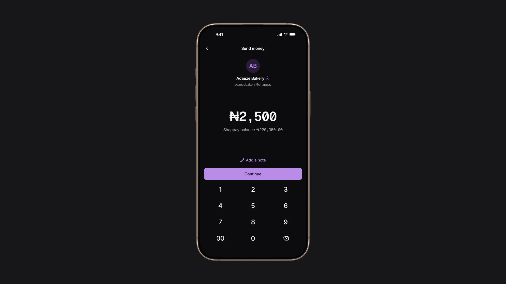
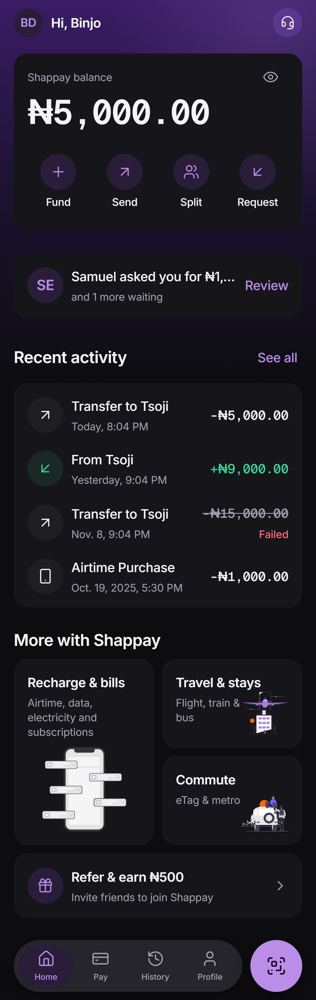
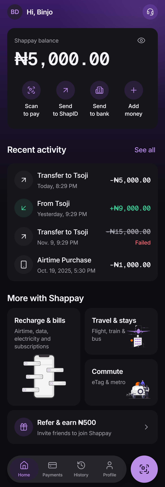
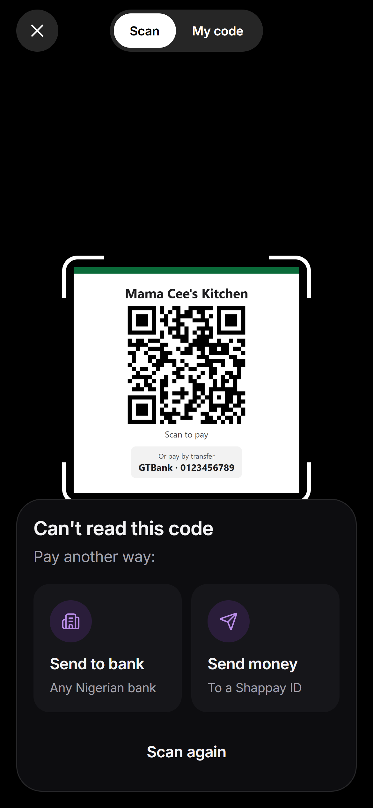
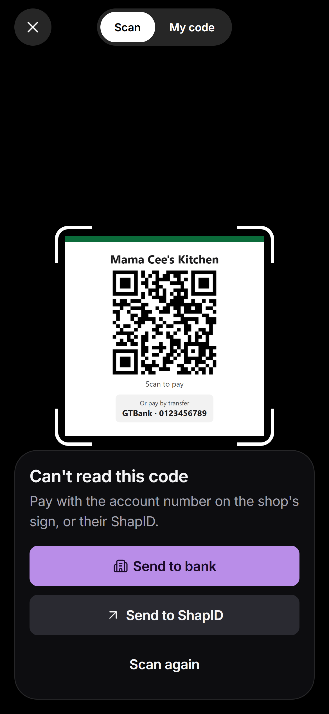
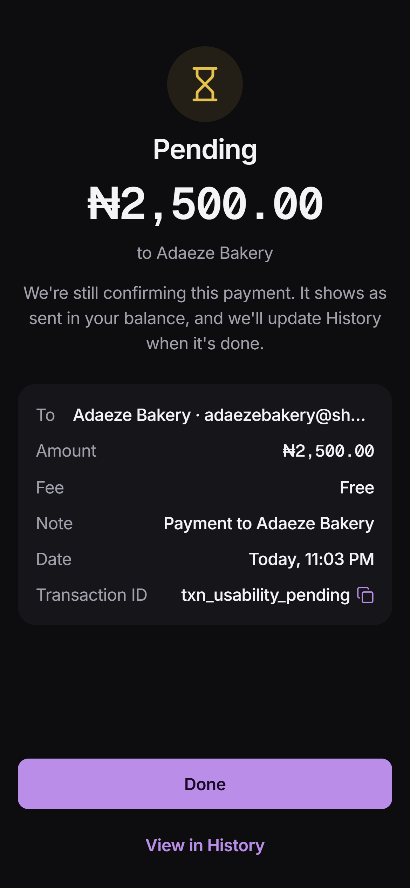
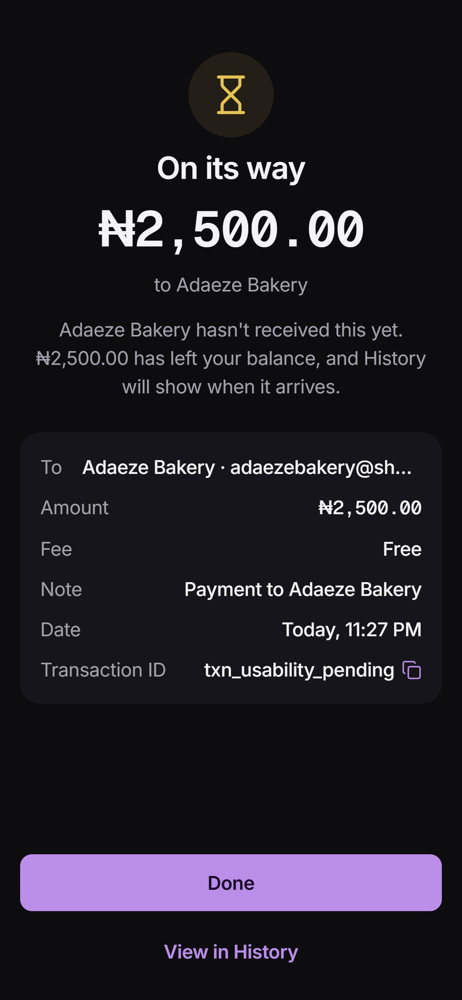

# Redesigning Shappay's ways to pay

A usability test showed that people couldn't find Shappay's ways to pay, so I redesigned the payment screens and ran the same test on the redesign.

| | |
|---|---|
| **Role** | Design engineer, leading product design |
| **Team** | Me; a product manager, who agreed and approved the redesign's scope; a frontend engineer, who reviewed and merged it; and a backend engineer, who built the ShapID lookup |
| **Timeline** | 2025 to now; tests in November 2026 |
| **Platform** | React Native with Expo, one codebase for phone and web |

**TL;DR:** Shappay is building an interoperable QR for Nigeria: one code a customer of any bank can pay, and a scanner that reads any code made to the national standard. In testing, people with a QR code or a ShapID in front of them still went to bank transfer. After the redesign, paying by scan rose from 5/8 to 8/8 testers, and getting past a code the app couldn't read from 4/8 to 8/8, measured in usability tests on a web build with a simulated scan.

*Paying by scan in the current app, from Home to sent, on sample data. The web build has no camera, so the scan is simulated. (Plays as a loop on the page.)*

## People reached for the account number they knew

Sending money in Nigeria means typing a 10-digit account number and hoping the name that comes back is the one you meant. Shappay exists to remove that step. But in the first design, no task reached its bar: between 4/8 and 6/8 testers completed each one. In tasks that needed a scan or a ShapID, testers opened bank transfer at least 10 times, and at least 3 wrong payments went through it.

The same unmoderated test ran twice, each time with a different 8 people in Nigeria who send money from their phones, recruited from my friends and contacts. Pass bars were set before testing, and one scoring rule judged both designs: the right person paid by the right route.

## What the first test showed

1. **Scan was hard to find, but easy to use.** 5/8 didn't go straight to Scan. Its button had an icon and no label. Everyone who did open Scan reached the amount screen without trouble.
2. **"Send" read as "send to a bank account".** People with a code or an ID still chose the habit.
3. **The card for an unreadable code only half worked.** Four tapped Send money first, which pays a ShapID, when the sign showed a bank account number.
4. **"Pending" read as "paid".** 3/8 said the shop had been paid; "sent" was the word they kept.

## Home names every way to pay

The row of Fund, Send, Split and Request became Scan to pay, Send to ShapID, Send to bank and Add money. Scan leads because the product is built on it. Request and Split moved into the payments tab, one tap further away; I expected them to stay easy to find there, and added a request task to the retest to check.

*Cropped just below the action row. Before: Fund, Send, Split and Request. After: four ways to pay, named the way people say them.*

<strong>Visual: Options explored</strong>

<strong>Show:</strong> The three Home row options from the decision log side by side: keep Fund, Send, Split, Request; rename them; rebuild the row around ways to pay. One line under each on why it lost or won.

<strong>Why:</strong> The decision log lists the options in words only; this shows the reasoning behind the row the retest proved.

## A code it can't read still gets paid

Until the scanner reads every code, a code it can't read still gets paid. Send to bank became the main button and Send to ShapID the second, because the shop's sign shows an account number. The title stayed "Can't read this code", because the code may be fine and simply belong to another provider.

*Before: two equal options. After: Send to bank leads, Send to ShapID comes second.*

<strong>Visual: Prototype clip</strong>

<strong>Show:</strong> A short loop on the current app: a code that won't read, the card, Send to bank, the account number from the sign, review and sent. Same frame and canvas as the scan to pay clip.

<strong>Why:</strong> Getting past an unreadable code went from 4/8 to 8/8; the flow behind that number is only shown as stills.

## Pending says what it means

"Pending" became "On its way", with the name in the sentence: "Adaeze Bakery hasn't received this yet."

*"On its way" leaves no room to read it as paid.*

## Results: what held, what still failed, what broke

| Task | First design | Redesign |
|---|---|---|
| Scan a shop's code and pay | 5/8 | 8/8 |
| Pay when the code can't be read | 4/8 | 8/8 |
| Tell whether a pending payment has arrived | 5/8 | 7/8 |
| Add money, then pay | 6/8 | 7/8 |
| Send to a friend's ShapID | 4/8 | 5/8 |
| Ask a friend for money | not tested | 4/8 |

The same tasks, a different 8 testers each time, scored by the same rule. Paying a ShapID still misses the bar of 7/8: two testers tapped the only name in the new Recent list on a task about someone else. Request, which this redesign moved off Home, was found by only 4/8; the next build puts it back on Home, not yet tested.

Shappay is still in development. After launch, the measure of success is the share of payments made by scan or ShapID instead of a typed account number, and the target is 90%. [ADD: why 90%, if you want it on the page]

<strong>Visual: Annotated screen</strong>

<strong>Show:</strong> The Payments tab bars of Monzo and Wise next to Shappay's, labels circled, as a small reference strip beside the "Pay" to "Payments" change.

<strong>Why:</strong> The tab name rests on the claim that Monzo and Wise use Payments for the same set, which is currently asserted, not shown.

## What I'd do differently

- **Test the cost of every move.** Moving Request off Home was a decision about space, not about people. Every feature I move now gets a task of its own.
- **Make sample data look like a real phone.** The Recent list held one name; real recents hold several, and a lone name invites a wrong tap.
- **Trust completion over ease.** Testers rated tasks 10/10 after paying the wrong person. Whether the right person got paid is the number that held up.

---

## Before you publish

Placeholders to fill, in order:

- [ ] [ADD: why 90%, if you want it on the page]

Visuals to make (the sky blue boxes above):

- [ ] Options explored: the three Home row options, with why each lost or won
- [ ] Prototype clip: unreadable code to Send to bank on the current app
- [ ] Annotated screen: Monzo and Wise Payments tabs beside Shappay's
